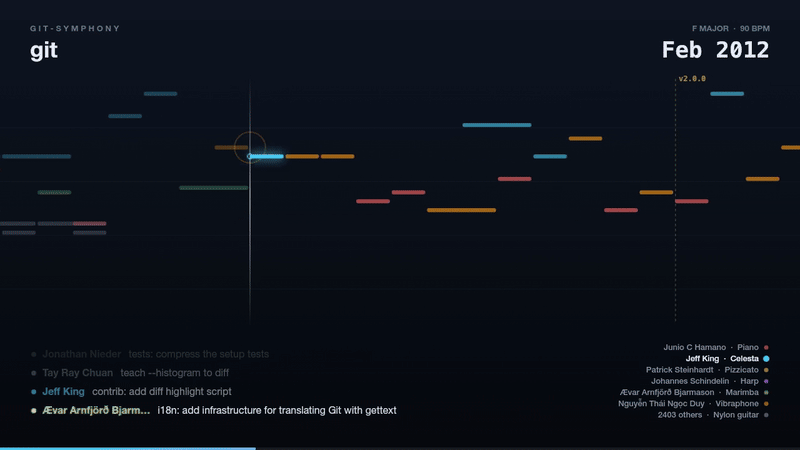

# git-symphony

**Turn any git repository's history into a minute of music.** Every commit is a note, every top contributor is an instrument, every release is a cymbal swell.

[](docs/demo.mp4)

*Above: [git/git](https://github.com/git/git), 2005 to today, in 60 seconds. Junio C Hamano is the piano, Jeff King the celesta, 2,403 other contributors share a nylon guitar. **[Watch with sound (mp4)](docs/demo.mp4)**.*

## Quickstart

```sh
npx git-symphony path/to/repo            # -> repo-symphony.mid + repo-symphony.wav
npx git-symphony path/to/repo --video    # also repo-symphony.mp4 (needs ffmpeg)
```

From source:

```sh
git clone https://github.com/balx/git-symphony && cd git-symphony
npm install
node src/cli.js ~/code/my-project --video
```

Needs Node 20+. The first run downloads the [GeneralUser GS](https://github.com/mrbumpy409/GeneralUser-GS) soundfont (31 MB, checksum-verified) to `~/.cache/git-symphony`. No other system dependencies for audio; `--video` uses `ffmpeg`.

```
Options:
  -l, --length <sec>  length of the piece in seconds (default 60)
  -o, --out <path>    output path without extension (default ./<repo>-symphony)
      --video         also render an .mp4 visualization
```

## Why it sounds the way it does

- **Time**: the whole history is squeezed onto an 8th-note grid at 90 BPM (half calendar time, half commit order, so quiet years shrink but don't vanish).
- **Who**: the top 6 contributors each get an instrument (piano, celesta, pizzicato, harp, marimba, vibraphone); everyone else shares a guitar.
- **What**: each commit's busiest directory picks its note (a recurring phrase shape moves it through the bar), always from the major pentatonic and snapped to the current chord on the beat, so nothing clashes; bigger commits play louder and longer, the biggest become chords.
- **When**: strings and bass play a 4-chord progression underneath; busier stretches add bass movement and drums; major releases get a cymbal swell and tubular bells. The key and progression come from the repo's first commit hash, so every repo has its own sound, and the same repo always sounds the same.

## Output

- `.mid`: one track per instrument, named after its contributor. Open it in GarageBand, Logic, Ableton or MuseScore and remix it.
- `.wav`: 48 kHz stereo, rendered with sampled instruments, mastered to -14 LUFS (streaming loudness) with a -1.5 dBFS peak limiter.
- `.mp4`: 1280x720 piano roll, notes colored per contributor, the date and commit messages synced to the music.

## Credits

- Sounds: [GeneralUser GS](https://github.com/mrbumpy409/GeneralUser-GS) v2.0.3 by S. Christian Collins, which may be used "without restriction" in software projects ([license](https://github.com/mrbumpy409/GeneralUser-GS/blob/main/documentation/LICENSE.txt)). It is downloaded at first run, not bundled.
- Synthesis: [spessasynth_core](https://github.com/spessasus/spessasynth_core). Video frames: [@napi-rs/canvas](https://github.com/Brooooooklyn/canvas).

## License

MIT
